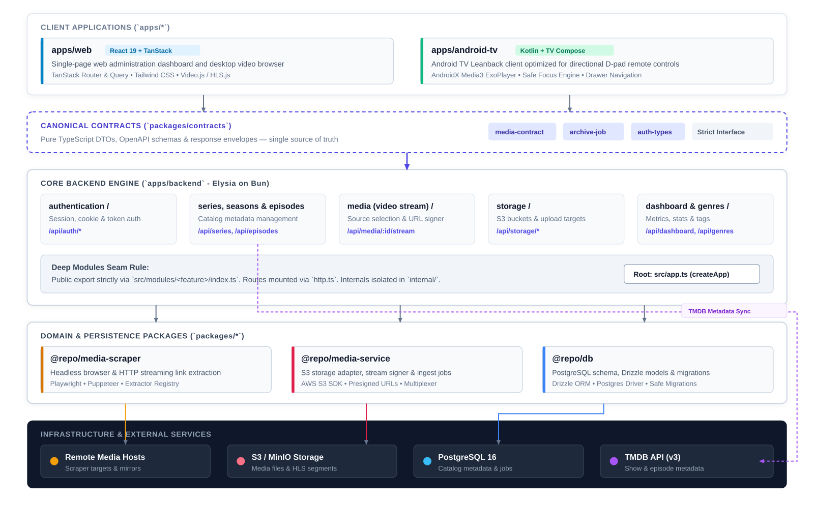

# System Architecture & Monorepo Codemap

Welcome to the architectural specification for **Private Movie** — a private media streaming and archival platform engineered as a modular TypeScript monorepo with deep module boundaries, strict canonical contracts, and an Android TV Leanback companion client.

---

## 1. High-Level System Architecture

The following diagram maps the application layers, contract seams, domain packages, and external infrastructure touchpoints:



> [!TIP]
> An interactive vector rendering is available in [`docs/diagrams/architecture-codemap.html`](docs/diagrams/architecture-codemap.html) and [`docs/diagrams/architecture-codemap.svg`](docs/diagrams/architecture-codemap.svg).

---

## 2. Monorepo Topology & Responsibility Matrix

Private Movie is organized into clear application frontends and domain-isolated shared packages:

```
private-movie/
├── apps/
│   ├── backend/         # Core API engine (Bun + Elysia + Deep Modules)
│   ├── web/             # Single-page web admin & viewer (React 19 + TanStack)
│   └── android-tv/      # Leanback TV client (Kotlin + Jetpack Compose for TV)
├── packages/
│   ├── contracts/       # Pure TypeScript DTOs, schemas & OpenAPI definitions
│   ├── db/              # PostgreSQL schema, Drizzle ORM models & migrations
│   ├── media-service/   # S3 storage manager, stream signer & archival orchestrator
│   ├── media-scraper/   # Headless browser & HTTP scraper engines
│   └── config-vitest/   # Shared Vitest test configuration & environment stubs
└── docs/
    ├── DOMAIN.md        # Canonical terminology, context maps & invariants
    └── diagrams/        # Vector diagrams & state machines
```

### Application Components

| Application           | Technology Stack                                            | Primary Purpose                                                                                      | Architectural Role                                                                                                                                 |
| :-------------------- | :---------------------------------------------------------- | :--------------------------------------------------------------------------------------------------- | :------------------------------------------------------------------------------------------------------------------------------------------------- |
| **`apps/backend`**    | Elysia, Bun, Drizzle ORM                                    | Exposes HTTP REST API, handles authentication, routes media playback queries, triggers scraper jobs. | **Core Service**: Follows Deep Modules (`src/modules/<feature>/index.ts` public seam, `http.ts` route plugin, `internal/` implementation details). |
| **`apps/web`**        | React 19, TanStack Router & Query, Tailwind CSS             | Web administration dashboard, catalog browser, scraper management, video player.                     | **Web Client**: Consumes canonical types from `@repo/contracts`.                                                                                   |
| **`apps/android-tv`** | Kotlin, Jetpack Compose for TV, AndroidX Media3 / ExoPlayer | Living room television streaming client optimized for directional D-pad remote control.              | **Native TV Client**: Consumes `/api/media` and `/api/series` endpoints using typed HTTP transport.                                                |

### Shared Packages

| Package                   | Purpose & Bound                                                                                                    | Constraints                                                                                  |
| :------------------------ | :----------------------------------------------------------------------------------------------------------------- | :------------------------------------------------------------------------------------------- |
| **`@repo/contracts`**     | Canonical TypeScript types, request/response DTOs, OpenAPI schemas, and validation shapes.                         | **Pure TypeScript**: Zero dependencies on Elysia, React, or Drizzle. Single source of truth. |
| **`@repo/db`**            | PostgreSQL table definitions, relational schemas, constraints, and migration scripts.                              | **Persistence Only**: Changes to schema generate SQL migrations via `bun run db:generate`.   |
| **`@repo/media-service`** | S3/MinIO bucket abstraction, presigned URL generator, HLS streaming segment coordinator, ingest worker.            | **Storage Engine**: Communicates with object storage backends.                               |
| **`@repo/media-scraper`** | Automated web scrapers (Playwright/Puppeteer), provider registry, anti-bot handling, and streaming URL extractors. | **Extractor**: Emits canonical `DirectStreamPayload` objects; has no direct DB dependencies. |
| **`@repo/config-vitest`** | Shared Vitest test presets, environment setup, and silent logging configuration.                                   | **Tooling**: Standardizes test execution monorepo-wide.                                      |

---

## 3. Communication Flows & Data Vectors

### 1. Contract-First API Flow

Every HTTP endpoint implemented in `apps/backend` and consumed by `apps/web` or `apps/android-tv` originates in `@repo/contracts`:

1. Contract defined in `packages/contracts/src/<feature>.ts`.
2. Mounted into Elysia routes in `apps/backend/src/modules/<feature>/http.ts`.
3. Consumed in frontend React queries (`apps/web`) or network models (`apps/android-tv`).

### 2. Media Ingestion & Archival Flow

When a user submits a stream URL for archival:

1. `apps/backend` creates a pending `ArchiveIngestJob` row in PostgreSQL.
2. `@repo/media-scraper` executes the appropriate provider extractor in a sandboxed headless browser to extract raw stream URLs.
3. `@repo/media-service` downloads or verifies the media stream and pipes it into configured S3/MinIO storage.
4. The job updates to `completed`, attaching a new `VideoSource` record to the target `Episode` or `Movie`.
   _(For state machine details, see [docs/DOMAIN.md](docs/DOMAIN.md#4-media-ingestion-state-machine))._

### 3. Media Playback Flow

When a video is requested by a client:

1. Android TV or Web client queries `/api/media/:id/stream`.
2. `apps/backend` queries the associated `VideoSource` and storage credentials.
3. If stored on S3, `@repo/media-service` generates a time-limited presigned streaming URL.
4. Client receives the stream payload and initializes playback via ExoPlayer (Android TV) or Video.js / HLS.js (Web).

---

## 4. Architectural Rules & Governance

- **Deep Modules**: All features in `apps/backend` must expose only an `index.ts` entry point and an `http.ts` route plugin. Never import from another module's `internal/` folder.
- **Contract Boundary**: Changes to API payloads must be committed to `packages/contracts` first.
- **Database Safety**: Direct schema pushing (`db:push`) is strictly prohibited. Schema modifications require migration file generation (`db:generate`) and manual review.
- **Cross-Reference**: For full domain models, entity invariants, and ubiquitous language, see [docs/DOMAIN.md](docs/DOMAIN.md).
