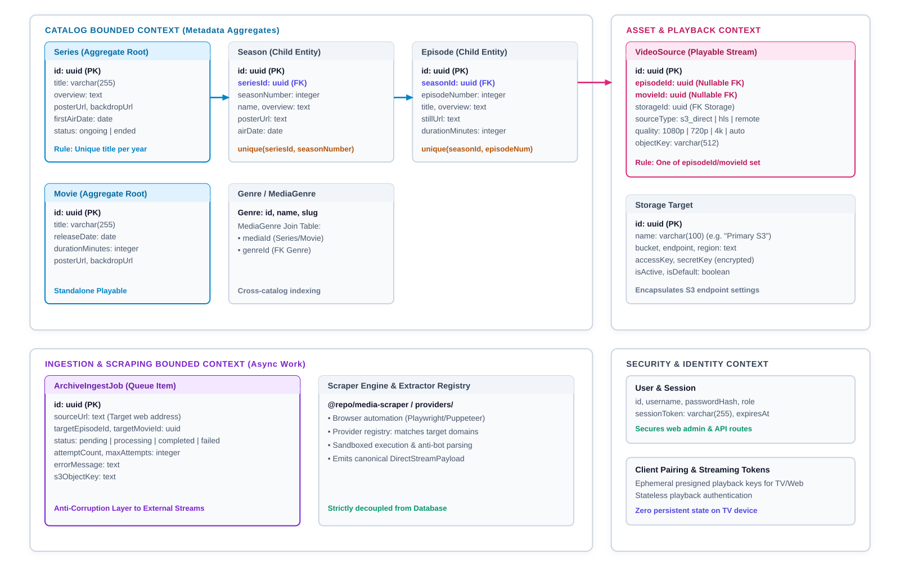
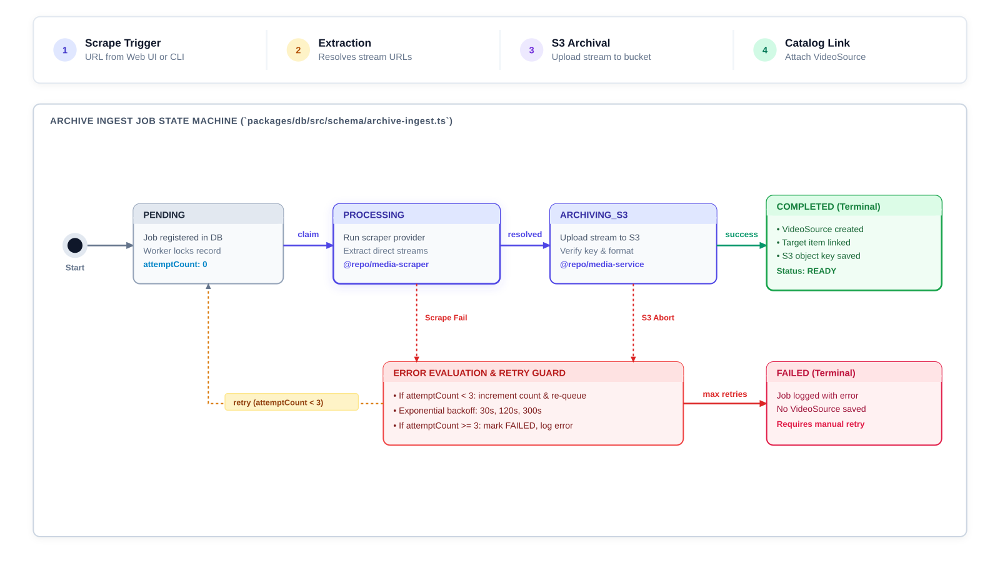

# Domain Glossary & Bounded Context Map

This document establishes the **Ubiquitous Language**, **Bounded Contexts**, **Entity Invariants**, and **Lifecycle State Machines** for the Private Movie system.

---

## 1. Domain Context Map

The following map defines the four core bounded contexts, their aggregates, and cross-context boundaries:



> [!TIP]
> An interactive vector rendering is available in [`docs/diagrams/domain-context-map.html`](diagrams/domain-context-map.html) and [`docs/diagrams/domain-context-map.svg`](diagrams/domain-context-map.svg).

---

## 2. Ubiquitous Language & Core Terminology

| Term                   | Domain Definition                                                                                                                                            |
| :--------------------- | :----------------------------------------------------------------------------------------------------------------------------------------------------------- |
| **Series**             | Top-level episodic catalog entity representing a television show or anime series. Acts as the aggregate root for seasons and episodes.                       |
| **Season**             | An ordered collection of episodes belonging to a specific `Series`. Identified by its 1-indexed `seasonNumber`.                                              |
| **Episode**            | The individual atomic playable unit within a series. Must belong to a parent `Season` and `Series`. Identified by `episodeNumber`.                           |
| **Movie**              | A standalone playable catalog entity that exists independently of seasons or series.                                                                         |
| **VideoSource**        | A concrete playable stream or media file pointing to physical storage (e.g., S3 object key or external remote stream URL) linked to an `Episode` or `Movie`. |
| **Storage Target**     | An S3/MinIO compatible object store configuration (bucket name, endpoint, credentials, regional settings) where media files and HLS streams are preserved.   |
| **Archive Ingest Job** | An asynchronous pipeline job that fetches a third-party streaming link, scrapes underlying video streams, and archives the stream into object storage.       |
| **Provider**           | A domain scraper plugin inside `@repo/media-scraper` tailored to extract stream links from a specific external hosting provider or website.                  |
| **Direct Stream**      | An unencumbered direct video URL (e.g., `.m3u8` master playlist or `.mp4` binary) extracted by a scraper.                                                    |

---

## 3. Entity Invariants & Integrity Rules

### Catalog Invariants

1. **Hierarchy Strictness**: An `Episode` cannot exist without a parent `Season`, which cannot exist without a parent `Series`. Deleting a `Series` cascades down to delete its seasons and episodes.
2. **Season Numbering**: Within a given `Series`, `seasonNumber` must be unique (`UNIQUE(series_id, season_number)`).
3. **Episode Numbering**: Within a given `Season`, `episodeNumber` must be unique (`UNIQUE(season_id, episode_number)`).
4. **Media Ownership of VideoSource**: Every `VideoSource` must be bound to **either** an `episodeId` or a `movieId`. It is an invalid domain state for both or neither to be null.

### Storage & Asset Invariants

1. **Object Key Determinism**: S3 object keys must adhere to canonical directory paths:
   - Series episodes: `series/{seriesId}/s{seasonNumber}/e{episodeNumber}/{quality}.mp4` (or `/master.m3u8`)
   - Movies: `movies/{movieId}/{quality}.mp4`
2. **Bucket Isolation**: Video assets and thumbnail/poster images may share an S3 bucket under distinct top-level prefixes (`/videos/` vs `/images/`), or reside in separate storage targets.

---

## 4. Media Ingestion State Machine

Asynchronous archival jobs transition through strict states to maintain data integrity:



> [!TIP]
> An interactive vector rendering is available in [`docs/diagrams/ingest-lifecycle.html`](diagrams/ingest-lifecycle.html) and [`docs/diagrams/ingest-lifecycle.svg`](diagrams/ingest-lifecycle.svg).

### Transition Rules & Lifecycle States

```
[Start] ──> PENDING ──(claim)──> PROCESSING ──(resolved)──> ARCHIVING_S3 ──(success)──> COMPLETED
               ▲                      │                           │
               │                      │                           │
               │               (scrape error)               (upload abort)
               │                      │                           │
               │                      ▼                           ▼
               └──(retry < 3)── ERROR EVALUATION & RETRY GUARD
                                      │
                               (retries >= 3)
                                      ▼
                                    FAILED
```

1. **`pending`**: The job has been persisted in PostgreSQL (`archive_ingest_jobs` table). Worker processes poll or listen for pending jobs.
2. **`processing`**: A worker has claimed the job lock. `@repo/media-scraper` launches a browser extractor to locate stream playlists.
3. **`archiving_s3`**: Stream URLs are verified. `@repo/media-service` downloads or multiplexes segments into the destination S3 bucket.
4. **`completed`**: Terminal success. The S3 object is validated, and a new `VideoSource` row is linked to the target media entity.
5. **`failed`**: Terminal failure. Occurs after 3 unsuccessful attempts or fatal unrecoverable errors. Requires manual review or manual re-triggering.

---

## 5. Bounded Context Integration

- **Catalog &rarr; Asset Context**: Loose coupling. The catalog identifies what media exists, while `VideoSource` models where and how it can be streamed.
- **Ingestion &rarr; Catalog Context**: Downstream relationship. Ingestion workers never mutate episode metadata directly; upon completion, they append a `VideoSource` reference to the catalog item.
- **Scraper &rarr; Ingestion Context**: Anti-Corruption Layer. The scraper engine produces pure `DirectStreamPayload` objects without awareness of PostgreSQL schemas or S3 bucket layout.
